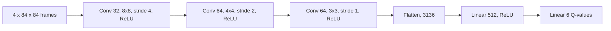
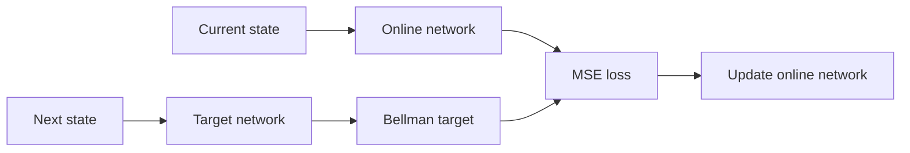

# Air Raid DQN

## Project Introduction

This project trains a Deep Q-Network to play an Atari game by interacting with the environment. The agent, the replay buffer, and the training loop are written in PyTorch and Gymnasium. The training script is [`train.py`](train.py). The playback script is [`play.py`](play.py).

## Group members

- Kagaba Etienne
- Joella Teta
- Vestine Umukundwa

## Selected Atari environment

The environment is Air Raid, `ALE/AirRaid-v5`. The player moves a ship and fires at incoming enemies. Destroying an enemy scores points. The episode ends when the player is destroyed.

Training and play build the observation in the same way. `gym.make` uses `frameskip=1`. `AtariPreprocessing` converts each frame to an 84×84 grayscale image, skips 4 frames, and scales pixel values to `[0, 1]`. `FrameStackObservation` stacks the last 4 frames, so the network sees shape `(4, 84, 84)`. Air Raid has 6 actions.

## DQN Architecture

The `DQN` class in [`train.py`](train.py) is a small convolutional network. The agent keeps two copies. The online network is the one that is trained and the one that chooses actions. The target network starts as a copy of the online network and is used only to build the Bellman target. Every 1000 steps it is replaced with a fresh copy of the online network. The saved checkpoint is the online network's weights.

The layers, for an input of `(4, 84, 84)`, are:

- Conv2d, 32 filters, kernel 8, stride 4, then ReLU. The spatial size becomes 20.
- Conv2d, 64 filters, kernel 4, stride 2, then ReLU. The spatial size becomes 9.
- Conv2d, 64 filters, kernel 3, stride 1, then ReLU. The spatial size becomes 7.
- Flatten to 3136 values.
- Linear layer of 512 units, then ReLU.
- Linear layer of 6 units. These are the Q-values, one per action, with no activation.

## Diagrams of the network architecture

The Q-network:



One training update. Only the online network is updated:



## Explanation of the training process

Each episode resets Air Raid and then repeats the following until the episode ends.

The agent stores every transition in a replay buffer that holds 100,000 transitions. When the buffer is full, the oldest transition is dropped.

The action is chosen with ε-greedy. With probability epsilon the agent takes a random action. Otherwise it takes the action with the largest Q-value from the online network. Epsilon starts at 1.0 and decays toward 0.05 over 50,000 environment steps.

Once the buffer has enough transitions, the agent samples a batch. The online network predicts the Q-value of the action that was actually taken. The target network predicts the Q-values of the next state. The target value is `reward + gamma * max target Q(next state) * (1 - done)`, with gamma 0.99. If the episode ended, the future term is zero.

The loss is the mean squared error between the predicted Q-value and that target. Adam updates the online network. Gradients are clipped to 100. Every 1000 steps the target network copies the online network.

At the end of each episode the script records the episode length, the total number of steps, and the reward. A finished run saves `dqn_model.pth` and `training_performance.csv` in the project root.

The settings below are the constants at the bottom of [`train.py`](train.py). Change a value, save the file, and run the script again.

| Constant | Default | What it controls |
| --- | --- | --- |
| `LR` | `1e-4` | Adam learning rate |
| `GAMMA` | `0.99` | Discount factor for future rewards |
| `BATCH_SIZE` | `32` | Transitions sampled from the replay buffer each update |
| `EPS_START` | `1.0` | Starting exploration rate |
| `EPS_END` | `0.05` | Lowest exploration rate after decay |
| `EPS_DECAY` | `50000` | How quickly epsilon falls from `EPS_START` to `EPS_END`, in environment steps |
| `MEMORY_CAPACITY` | `100000` | Maximum transitions stored in the replay buffer |
| `TARGET_UPDATE_FREQ` | `1000` | How often the target network copies the online network, in steps |
| `NUM_EPISODES` | `500` | Number of episodes to train |

Each member's experiments and what changed are written up separately:

- [Kagaba Etienne](Kagaba_Etienne_Hyperparameter_experiment_results.md)
- [Joella Teta](Joella_Teta_Hyperparameter_experiment_results.md)
- [Vestine Umukundwa](Vestine_Umukundwa_Hyperparameter_experiment_results.md)

### Install

Python 3.14 and [uv](https://docs.astral.sh/uv/). uv is the package and environment manager for this project. From the project root:

```bash
uv sync
uv run python train.py
```

`uv sync` creates `.venv` and installs PyTorch, pandas, NumPy, ALE, and Gymnasium with the Atari extras. The Air Raid ROM ships inside the `ale-py` package.

## Gameplay Demonstration

[`play.py`](play.py) loads `dqn_model.pth`, rebuilds the same network, and plays one episode in a window. Actions are greedy: the agent always takes the action with the highest predicted Q-value. The window stays open until the episode ends.

The `dqn_model.pth` in this repository is Kagaba Etienne's 11th experiment, [models/Kagaba_Etienne/experiment_11_mse_fast_clipped_batch64/dqn_model.pth](models/Kagaba_Etienne/experiment_11_mse_fast_clipped_batch64/dqn_model.pth). That run uses MSE loss, clipped rewards, a gradient step every 4 environment steps, observation scaling on the GPU, and batch size 64.

```bash
uv run python play.py
```

Pass a checkpoint path to play a different saved model:

```bash
uv run python play.py models/Kagaba_Etienne/experiment_11_mse_fast_clipped_batch64/dqn_model.pth
```

Recordings of this agent playing Air Raid are at [videos/](videos/).

[](https://www.youtube.com/watch?v=JLx54uYqQC4)   
[](https://www.youtube.com/watch?v=WhA_2Ut_QsE)   
